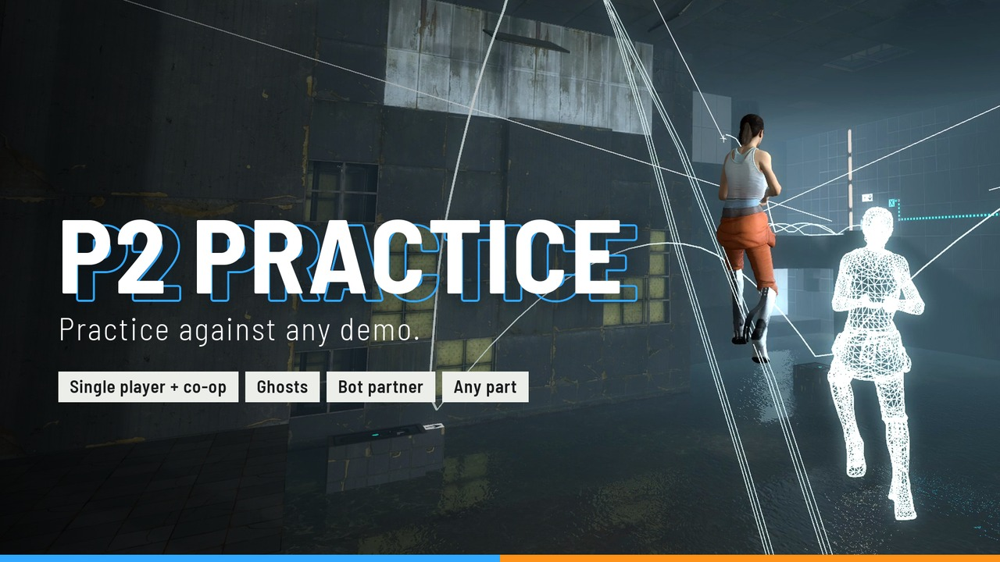
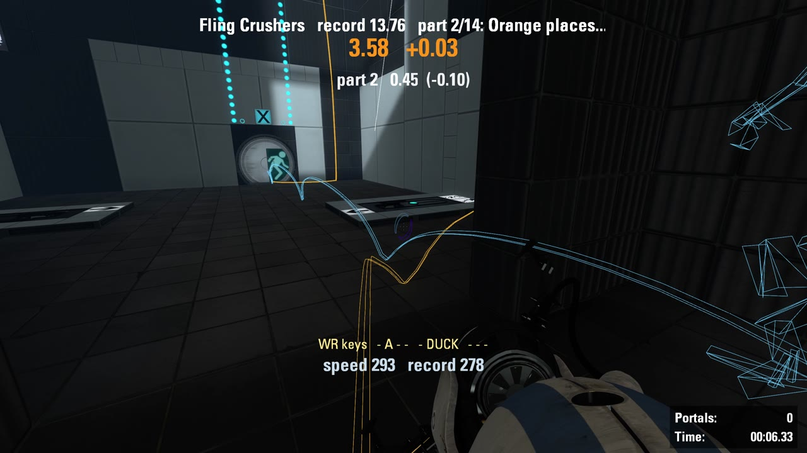
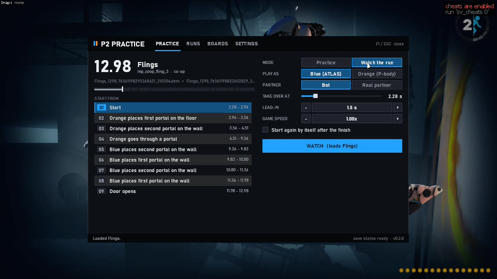
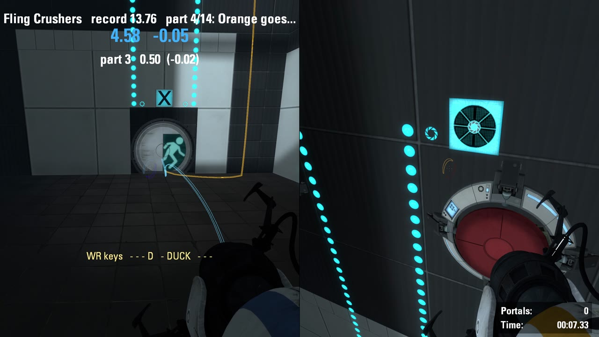
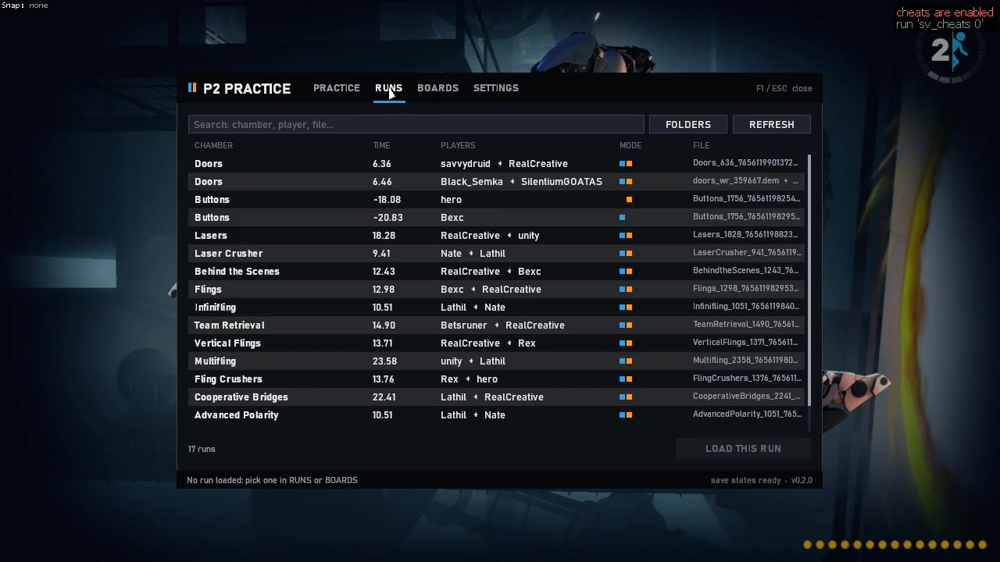
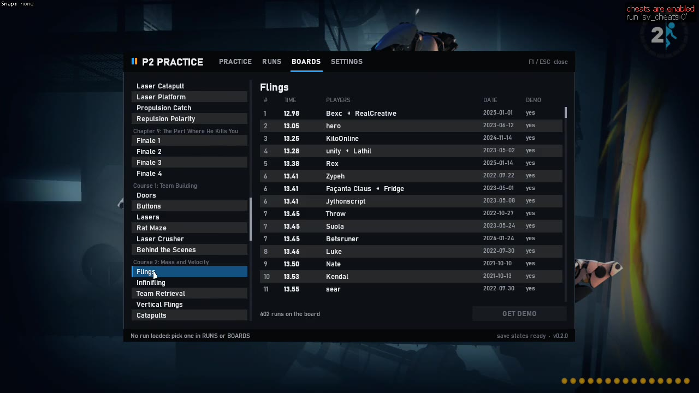
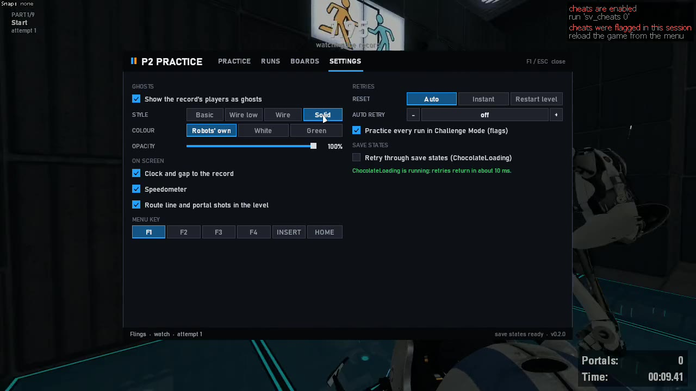

<div align="center">



# P2 Practice

**Practice a Portal 2 speedrun against a demo, inside the real game.**

[](https://github.com/PortalRex/p2-practice/releases/latest)
[](https://github.com/PortalRex/p2-practice/releases)


[**Download**](https://github.com/PortalRex/p2-practice/releases/latest) ·
[Quick start](#quick-start) ·
[Features](#features) ·
[Menu](#the-in-game-menu) ·
[Commands](#console-commands) ·
[Save states](#save-states)

</div>

---

Give it a run (a `.dem`, or both players' demos of a co-op run) and it puts you on that run's route:

- 👻 the recorded players run beside you as **ghosts**,
- ⏱️ a **clock** shows how far ahead or behind you are,
- 🎯 you can **start from any part** of the run, with the run's exact position, aim, speed and portals.

It is a standalone server plugin (`p2practice.dll`) with an optional launcher (`P2Practice.exe`). It works beside
SAR and p2boost, on DirectX 9 and with `-vulkan`.

<table>
  <tr>
    <td width="50%"></td>
    <td width="50%"></td>
  </tr>
  <tr>
    <td align="center"><sub>Racing the record: the clock and gap, the route in the level, the partner's ghost</sub></td>
    <td align="center"><sub>The in-game menu: pick a part and start</sub></td>
  </tr>
</table>

> [!IMPORTANT]
> **Nothing you do in practice can reach a leaderboard.** Practice moves players, objects and portals, so it turns
> `sv_cheats` on. With cheats on the game records no Challenge Mode score and SAR submits nothing.
> [More](#cheats-and-leaderboards)

## Contents

**Using it**

- [Features](#features)
- [Quick start](#quick-start)
- [The in-game menu](#the-in-game-menu)
- [The launcher](#the-launcher)
- [Console commands](#console-commands)
- [Settings](#settings)

**How it behaves**

- [How a part starts](#how-a-part-starts)
- [Save states](#save-states)
- [What a demo gives](#what-a-demo-gives)
- [Limits](#limits)
- [Cheats and leaderboards](#cheats-and-leaderboards)

**For developers**

- [How it works with the game](#how-it-works-with-the-game)
- [Building and testing](#building-and-testing)
- [Credits](#credits)

## Features

| Feature | What it does |
| --- | --- |
| 👻 **Ghosts** | The recorded players run the route beside you, animated the way the game animates a player. Wireframes in their portal colours, or solid robots in a colour and opacity you choose. |
| ⏱️ **Live clock** | How far ahead of or behind the run you are, a split for every part, and your speed next to the record's. At the Challenge Mode flags you get the time your run would have had. |
| 🧩 **Parts** | The run is cut into parts at its portal shots, portal trips and doors. Start from any part, or from any second: the run plays itself up to that moment (you ride along), then hands you the player. |
| 🤖 **Co-op alone** | Pick ATLAS or P-body. The other robot is a real second player driven through its half of the run from the demo: it moves, places its portals and presses its buttons on time, and you can stand on it. |
| 🤝 **Co-op together** | With a real partner, each of you gets your own ghost and clock. Only the host needs the plugin; the partner sees the ghosts and text too, and can type the `prac_` commands. |
| 🎥 **Ride along** | Watch the whole run from the runner's eyes, inside the level, at any speed. |
| 📊 **Replay and compare** | Play another run in the level against the loaded one, or print a part-by-part table of where it gains and loses. |
| 🛤️ **Route in the level** | A ribbon along the run's path ahead of you, in your portal colour, with a mark and an aim line for every portal shot. It is part of the level: walls hide it. |
| ⚡ **Save states** | With the bundled ChocolateLoading, a retry puts the whole level back in about 10 ms instead of restarting it. |
| 🐇 **Bhop trainer** | Speed gained per jump, how much of the air time gained speed, hop timing. |
| ✋ **Use trainer** | When the use key uses nothing: how many units out of reach or degrees off it was, and how many ticks early or late. |
| 📋 **In-game menu** | Press Insert: your demos, the leaderboards, how to practice and every setting, without leaving the game. |

<p align="center">
  <br>
  <sub>Co-op alone: you play one robot, the other is driven through its half of the run</sub>
</p>

## Quick start

1. Unzip the release anywhere. It holds `P2Practice.exe`, `p2practice.dll`, `p2route.exe`, `chocolateloading\` and
   this `README.md`.
2. Start practicing, with or without the launcher:

   - **With the launcher:** start `P2Practice.exe`, pick a run and press **Launch**. It puts the plugin into the
     Portal 2 folder itself.
   - **Without it:** copy `p2practice.dll` next to `portal2.exe`, type `plugin_load p2practice` in the game's
     console (or put it in your autoexec), and press **Insert**.

> [!NOTE]
> Load the plugin from a cfg or the console. Don't use `+plugin_load` if another plugin is loaded that way too: the
> game honours only one `+plugin_load` on its command line.

## The in-game menu

**Insert** opens it, in the main menu or in a level. Insert or Esc closes it. While it is open the game gets no
keys or clicks. To use another key, change it in SETTINGS or with `prac_menukey`.

| Page | What is on it |
| --- | --- |
| **PRACTICE** | The loaded run and how to practice it. |
| **RUNS** | Every demo in your folders. |
| **BOARDS** | The Challenge Mode leaderboards, with their demos. |
| **SETTINGS** | Ghosts (style, colour, opacity), what's on screen, retries, save states and the menu's key. |

### PRACTICE

Shows the loaded run: its time, chamber and parts, and a bar of the run with the point where you take over.

- **Where to start:** pick a part, drag the take-over point, or click the seconds next to TAKE OVER AT and type
  them.
- **How:** Practice or Watch, blue or orange, bot or real partner, lead-in and game speed.
- **START** begins. When the run's map isn't up, START loads it (`ss_map` for co-op with the bot). With a real
  partner the run is armed and starts once you both are in.
- **RETRY**, **NEXT PART** and **STOP** are there while practicing.

### RUNS

- Lists every demo in the folders you add, searched recursively. No folder is read until you add one: press
  **FOLDERS**. Runs fetched in BOARDS are listed too.
- Co-op pairs are shown as one run.
- Challenge Mode runs are marked in the MODE column: `CM` when the run reached the flags, `CM · no finish` when it
  didn't, and `CM · no SAR` when the demo has no SAR data to say.
- Click a column's name to sort (CHAMBER, TIME, FILE). Clicking **MODE** steps through every run, Challenge Mode
  runs, Challenge Mode runs that reached the flags, and the other runs.
- Demos are read in the background and cached in `portal2/p2practice/library.cache`.
- Type to search. **FOLDERS** adds a folder (paste its path with Ctrl+V) or removes one.
- Double-click a run, or press **LOAD THIS RUN**.

### BOARDS

The Challenge Mode leaderboards at [board.portal2.sr](https://board.portal2.sr), by chapter. Pick a chamber, then
double-click a run (or press **GET DEMO**): its demo or demos are downloaded into `portal2/demos/p2practice/boards`
and loaded.

### Screenshots

<table>
  <tr>
    <td width="50%"></td>
    <td width="50%"></td>
  </tr>
  <tr>
    <td align="center"><sub>RUNS</sub></td>
    <td align="center"><sub>BOARDS</sub></td>
  </tr>
  <tr>
    <td width="50%"></td>
    <td width="50%"></td>
  </tr>
  <tr>
    <td align="center"><sub>PRACTICE</sub></td>
    <td align="center"><sub>SETTINGS</sub></td>
  </tr>
</table>

### Good to know

- Settings are kept in `cfg/p2practice/settings.cfg`, which runs when the plugin loads.
- The HUD (clock and gap, part, speed, flashes) is drawn by the plugin. A partner over the network gets the game's
  text lines instead.

Console commands for the menu:

| Command | What it does |
| --- | --- |
| `prac_menu [practice\|runs\|boards [map]\|settings\|close]` | open the menu on a page, or close it |
| `prac_menukey <key>` | the key that opens the menu |
| `prac_folder_add <folder>` | add a demo folder |
| `prac_folders` | list the demo folders |
| `prac_menu_tour [record <video>]` | a scripted walk through the menu, recorded with SAR's renderer, for showing it |

## The launcher

`P2Practice.exe` lists the demos in the folders you add (co-op pairs as one run), shows the selected run's parts,
and starts the game with everything set up:

- which robot you play, and whether the partner is the bot or a real player,
- which part to start from, or any second of the run (TAKE OVER AT),
- practice or watch,
- what is shown and how the ghosts are drawn.

If the game is already running, the launcher writes `cfg/p2practice/launch.cfg` and puts `exec p2practice/launch`
on the clipboard for you to paste into the console.

The window follows Windows' light or dark mode, also when Windows is switched while it is open. Game > Light / Dark
sets it by hand.

### SAVE AS CFG

Writes the same session under a name of your own: `cfg/p2practice/<name>.cfg` in the game folder. Later,
`exec p2practice/<name>` in the game's console starts that practice again without the launcher, from the menu or
inside a level.

- The demo is used where it is. It is copied under `demos/p2practice/saved` only when the game can't read its path.
- The cfg's first line loads the plugin. When the plugin is already loaded, that line just says so.
- Cfgs that earlier versions saved straight into `cfg/` are moved into `cfg/p2practice/` the next time you launch
  or save one.

### BOARDS

Shows the Challenge Mode leaderboards. Pick a chamber, and every run on its board is listed with its time, players,
date and whether a demo is there.

- Enter or **Get demo** fetches the demo (both robots' for co-op) into `demos\boards` next to the launcher.
- A run whose demo is already in one of your folders shows as saved.
- Co-op runs are paired by their time and date, so a run whose partner has since set a better time appears alone.
  Its one demo still works: the partner's path then comes from the host's snapshots.

### SAVE STATES

Sets up [save states](#save-states) for you.

## Console commands

| Command | What it does |
| --- | --- |
| `prac_load <demo> [partner's demo]` | load the run to practice against (a path, or a name under `portal2/` or `portal2/demos/`) |
| `prac_info` | list its parts and events |
| `prac_start [part]` | practice from a part |
| `prac_goto <seconds>` | practice from any time of the run |
| `prac_nudge <seconds>` | take over this many seconds later in the run (negative: earlier) and start again |
| `prac_retry`, `prac_next`, `prac_prev` | again, next part, previous part |
| `prac_watch [part]` | ride along with the run |
| `prac_role <blue\|orange\|auto>` | co-op alone: the robot you play |
| `prac_replay <demo> [partner's demo]` | play another run in the level against the loaded one |
| `prac_compare <demo> [partner's demo]` | part-by-part times of another run against the loaded one |
| `prac_set [name value]` | [settings](#settings) |
| `prac_auto [watch] <part> \| [watch] at <seconds> \| off` | start by itself once the run's map is up (the launcher uses this) |
| `prac_stop` | stop |

**Loading a level yourself**

- Single player: `map sp_a2_laser_stairs`
- Co-op alone needs the level in split screen: `ss_map mp_coop_doors`

Maps are shown by their chamber names (Doors, Laser Stairs); commands take the file names as always.

**Useful binds**

```
bind f5 prac_retry
bind f6 prac_next
bind f7 prac_prev
bind f8 "prac_nudge -1"
bind f9 "prac_nudge 1"
```

F8 and F9 take over a second earlier or later.

## Settings

`prac_set <name> <value>` changes one. `prac_set` alone lists them all with their values.

**The run**

| Setting | What it is |
| --- | --- |
| `leadin` | seconds the run plays itself before you take over (1.5) |
| `speed` | game speed while practicing |
| `loop` | start again by itself after the finish |
| `autoreset` | retry by itself when this many seconds behind (0: never) |
| `reset` | how a retry gets back to the part's start: `auto`, `soft` or `reload` ([How a part starts](#how-a-part-starts)) |
| `challenge` | practice every run in Challenge Mode (1) |
| `snapshots` | retry through [save states](#save-states) |
| `partner` | co-op alone: the bot that plays the other robot |

**Ghosts**

| Setting | What it is |
| --- | --- |
| `ghost` | show the recorded players |
| `ghoststyle` | `basic`, `wirelow`, `wire` or `solid` (below) |
| `ghostcolor` | `team` for the robots' own colours, or three numbers 0-255 |
| `ghostopacity` | percent; below 100 the ghosts are see-through |

**On screen**

| Setting | What it is |
| --- | --- |
| `hud` | the clock, the gap to the record and the flashes |
| `speedometer` | your speed next to the record's, bottom left |
| `path` | the route and its portal shots drawn in the level |
| `strafe` | the bhop trainer |
| `use` | the use trainer (below) |

### Ghost styles

| Style | What is drawn |
| --- | --- |
| `basic` | a wireframe of the model's coarsest mesh, with its small triangles left out |
| `wirelow` | that mesh whole |
| `wire` | the full mesh |
| `solid` | the solid model |

The wireframe ghosts are copies of the game's own player models. The plugin writes them once, under the game
folder: `models/p2practice/` and `materials/p2practice/ghost/`.

- Chell's model has no coarser mesh (the game never shows her from outside), so her ghost is always the full mesh.
- A partner over the network doesn't have those files, so with one connected the ghosts are shown solid.

### The use trainer

After a press of the use key that used nothing, a line under the crosshair says:

- what the press was nearest to using (cube, button, ...),
- how many units closer, or how many degrees further round, it had to be,
- how many ticks early or late it came.

The numbers are asked of the game's own use search, so reach, line of sight and portals count as they do for the
key. The game goes on looking for an object for half a second after a press; an object it still picks up by itself
shows as picked up.

It works in single player, and for the host in co-op.

## How a part starts

Getting back to the start of a part means getting the level back too: doors, panels, cubes, and the things a level
does on its own clock (the lift you arrive in, droppers, timed doors). From the demo the plugin knows when the
level's state changed (SAR's records) and what the level's clock showed when the recording began.

There are three ways back. At the handover, whichever was used, you get the run's exact position, aim, speed and
portals, and whatever the run was carrying at that moment is put in your hands.

| Way | When | What happens |
| --- | --- | --- |
| **Instant** | nothing in the level has changed since the part's start | players, objects and portals are put back |
| **Restart and replay** | otherwise | the level restarts and the run is replayed quickly up to the part |
| **Save state** | [save states](#save-states) are on | the whole game goes back to a moment into the lead-in |

### Instant

Players, objects and portals are simply put back. This is used when both are true:

- the run records no change of the level (a door, a button, a panel) between the lead-in's start and where your
  last attempt got,
- the level's own clock hasn't run past the part's start. In single player it always has after an attempt.

### Restart and replay

The level restarts and the run is replayed quickly from the level's first tick up to the part ("setting up the
level..."). The game's sound is faded out until the lead-in; your volume setting is not touched.

- **Players.** The real players stand in for the run's players, on the level's own clock. Each game frame they are
  put where the run's player was when the frame began, and the game's own movement carries them through it. So
  they ride the lift and touch every trigger in the same frame the run did, tricks included (a button pressed and
  released within one frame, a trigger skipped at speed).
- **Carried objects** are moved along the path they took.
- **Objects that moved on their own** (thrown, rolling, in a funnel) are thrown the same way and left to the
  game's physics, and put back on their path only if they stray.

Every button, door and laser ends up as the run had it.

### Save state

With save states on, neither of the above is needed: the whole game goes back to a moment into the lead-in.

The first save state taken in a level is kept as its base. An attempt that starts before where the level has got
to (a door the run opened later) goes back to the base and replays the run quickly from there, instead of
restarting the level or, with Instant, leaving the door open.

### Choosing

The RETRY row (launcher and SETTINGS) or `prac_set reset` picks the way:

| Choice | Setting | What it does |
| --- | --- | --- |
| **Auto** | `reset auto` | Instant when it can, otherwise Restart and replay |
| **Instant** | `reset soft` | never restarts for the level's sake. Buttons, doors and panels stay as the last attempt left them, while what the run carried or threw is put back. Only for parts where that doesn't matter. |
| **Restart the level** | `reset reload` | always restarts |

Whatever the choice, the level restarts:

- after a finish at the flags, because they are gone (with save states the retry goes back to the save state
  instead),
- when the level isn't in the run's mode.

How often Auto restarts:

- **Co-op:** the driven partner keeps acting the run out after the handover, so most retries of a part with
  buttons or doors in it restart the level.
- **Single player:** the level's clock is past the part after any attempt, so every retry restarts.

Save states make all of that moot.

### Challenge Mode

Every run is practiced in Challenge Mode, whether or not it was made in it. `prac_set challenge 0` keeps a run's
own mode instead.

- **Getting into it.** A level loaded from START (or with `prac_auto` on) comes up in Challenge Mode on its first
  load. One you loaded yourself is restarted into it by the first attempt.
- **What it means.** The finish flags and the game's own timer are there, no saves are kept, and a death starts
  the level again.
- **The leaderboard at the start.** The game opens one a few seconds into the level, which pauses the game: it
  would stall the run playing itself, or land on an early handover. It is kept from opening while practicing.
- **The leaderboard at the flags** comes up as it always does, with the attempt's time in its Final box (the game
  itself shows "-" there with cheats on). The plugin's time next to the record's shows once it is closed.
- **Replay Map** on that leaderboard, and the menu's Restart Level, start the same attempt again as `prac_retry`
  does, instead of restarting the level.
- **Deaths.** In single player a death restarts the level and the attempt starts again by itself. In co-op a robot
  just respawns.

## Save states

With [ChocolateLoading](https://github.com/Blenderiste09/ChocolateLoading) (RAM snapshots of the whole game) the
plugin stores a snapshot a moment into each lead-in. A retry puts the whole level back as it was then, cubes,
doors, buttons and all, in about 10 ms, then plays the rest of the lead-in.

> [!IMPORTANT]
> Save states need **the ChocolateLoading that comes with P2 Practice** (the release's `chocolateloading\` folder),
> with its `snap_opt render_lock` left on. That build tells the plugin when a save or a restore is done, and keeps
> the game's queued rendering running through it. With the stock build, or with `snap_opt render_lock 0`, the
> plugin says so and retries restart the level as usual.

### Setting them up

ChocolateLoading has to start with the game.

**With the launcher:** the **SAVE STATES** switch does it all. It:

1. puts `chocoload.exe` and `chocolateloading.dll` into the Portal 2 folder,
2. starts the game through `chocoload.exe` (Steam must be running: it starts `portal2.exe` itself),
3. sets `prac_set snapshots 1`.

**Without the launcher:**

1. Copy `chocoload.exe` and `chocolateloading.dll` next to `portal2.exe`.
2. Once, in Steam: Portal 2 > Properties > Launch Options, put this first (the menu's SETTINGS page shows the
   exact line and copies it):

   ```
   "<Portal 2 folder>\chocoload.exe" %command%
   ```

3. Start the game with Steam's Play, then turn save states on in SETTINGS or with `prac_set snapshots 1`.

With another wrapper already in the launch options, chain them:

```
"...\P2Multi.exe" "...\chocoload.exe" %command% ...
```

### Using them

Once they are on, a retry goes through the save state. A retry is any of:

- `prac_retry` (bind it: `bind f5 prac_retry`), or RETRY in the menu,
- the game's own `restart_level`, the pause menu's Restart Level, and Replay Map on the finish board. While
  practicing, these retry the attempt instead of restarting the level.

The game's `reload` and loading a save are not retries. The menu's status line says "save states ready" when
ChocolateLoading is running and the right build.

### What to know

- **Memory.** Each snapshot takes about 350 MB (pagefile-backed). The plugin keeps one, replaced at every new
  part.
- **Not over the network.** With a partner connected, snapshots are off (a snapshot holds this computer's game
  only): retries then restart the level.
- **Rendering stays as you have it.** Queued (multi-threaded) rendering is left on. A save or a restore holds the
  render thread at a safe point for its few milliseconds; nothing is switched off and on.
- **A few threads are parked.** While save states are in use the plugin keeps `host_thread_mode`,
  `snd_mix_async`, `net_queued_packet_thread` and `r_threaded_particles` at 0. None of these costs frame rate, and
  none is saved: the next game start has your own values. The reasons: ChocolateLoading would otherwise switch the
  first three around every operation and wait four frames each time, and particles simulated on the job threads
  crashed the game after some restores.

### Demos with save states

A snapshot keeps every file open that was open when it was taken, the demo being recorded too. So:

- the demo is stopped just before each snapshot and before each restore, and a new one starts right after
  (`record ""`),
- every attempt is in a demo of its own, as when the level restarts for each,
- SAR stops and renames a finished one at the flags as usual,
- the plugin only starts a demo where one was being recorded.

The new demo is named by SAR as your srconfigs category asks (in Challenge Mode, the name the level's demo had).
Without SAR it is `demos/p2practice/<map>_<date>_<time>`.

### The bundled build

ChocolateLoading is Blenderiste09's, shipped with the release with their permission. The build shipped is the
stock one (commit 5a47744) with twelve changes. The first two are now part of ChocolateLoading itself.

Where the changes are, under `third_party/chocolateloading/`:

- `fixes.patch`: all of them in one patch
- `patches/`: one by one
- `README.txt`: explained at length

<details>
<summary>The twelve changes</summary>

| # | Change | What it fixed |
| --- | --- | --- |
| 1 | Its heap aligns memory to 16 bytes, as the game's own does | the game's SSE code crashed on gel maps with ChocolateLoading merely loaded |
| 2 | Memory the engine reserves through the Steam overlay's hook counts as the engine's | with the overlay on, the entity table was left out of snapshots: a crash a moment after a restore |
| 3 | `chocoload.exe` runs as Portal 2's Steam launch options, without a console window | save states without the launcher |
| 4 | A wait of more than 5 s for its heap lock is reported, with the holder | a freeze that left no trace |
| 5 | Cvars kept outside the snapshot keep a valid value across a restore | SAR's `sar_record_prefix` pointed at freed memory: mangled demo names, crashes |
| 6 | No 4-frame wait before an operation when the threading cvars have been 0 for a while | slow retries |
| 7 | Direct3D objects created through another plugin's device hook are tracked | with p2boost and `-vulkan`, a crash after a few retries |
| 8 | The device's state is saved with a snapshot and applied on a restore | flat yellow walls and missing shadows for seconds after a retry |
| 9 | An operation runs inside the material system's lock; queued rendering is never switched | a stutter per retry, and crashes on the render thread after restores |
| 10 | An export tells a plugin how many saves and restores are done and how many failed | the plugin knows the moment its operation finished instead of waiting a number of frames |
| 11 | A sound or video object that only another snapshot refers to is not destroyed twice | a crash when a save state was replaced after going back to an older one |
| 12 | The first save waits for its copy threads to be running (the author's own fix) | a freeze in the first save |

</details>

## What a demo gives

| Demo | What you get |
| --- | --- |
| **A host's demo recorded with SAR** | Everything: both players' paths, portals, the level's events and what was used. A co-op partner's path comes from 20 snapshots a second and has no key display. |
| **Plus the partner's own demo** | The partner's exact inputs and aim too. |
| **A demo without SAR's data** | Still works, but the clock starts at the spawn rather than the timer, and retries can't tell when the level changed. Use `prac_set reset reload`, or save states. |

### Times

- A run ends where its demo shows the flags touched.
- It lasts exactly its board time when the demo has the boards' name
  (`<Chamber>_<hundredths>_<steam id>_<id>.dem`, as the launcher and the menu download them). The reason: the two
  players' SAR timers are a tick off the board in about one run in twenty, and some demos have none.
- Without a board time, the longer of the two SAR timers is used (the board's choice in every such pair checked).
- Attempts are counted exactly as the demos count the record. A record replayed against itself (`prac_replay` of
  the loaded demos) prints its time at the flags and "+0 ticks".
- Times show as the boards show them, and a time level with the record reads exactly as the record does.

## Limits

- **Objects.** A demo holds an object's position about 20 times a second while the recording player can see it,
  and nothing while they can't (the plugin then leaves the object alone). A prop (cube, ball, box) gets the run's
  speed through a catapult trigger of the plugin's; a turret can only be placed. From the handover on, everything
  you touch follows the game's physics.
- **Co-op catches.** The game makes a robot that flies fast catch what it looks at (no key needed). Driven robots
  do the same, and let go when the run's robot did.
- **Co-op clock.** The level waits for both players before it starts, so there is no level clock to join: the
  run's clock starts when both robots stand in the level.
- **The finish** is the level's own Challenge Mode flags. Touching them (both robots, in co-op) ends the attempt
  and shows the time the flags would have shown; nothing is saved or submitted. Where a level has no flags (or
  `prac_set challenge 0` keeps a run out of Challenge Mode), the finish is where the run's player finished.
- **Altered maps.** A demo recorded on an altered copy of a map can't be followed on the real one (the level does
  different things). The plugin doesn't detect this; the run just won't line up.
- **The route line** is drawn on the host's screen only: a partner over the network doesn't see it.

## Cheats and leaderboards

Practice moves players, objects and portals, so it turns `sv_cheats` on. It keeps cheats on in every level it has
worked in until that level is left or loaded again, also after `prac_stop`, and also if you switch them off by
hand.

With cheats on the game records no Challenge Mode score and SAR submits nothing, so nothing you do in practice can
reach a leaderboard.

## How it works with the game

The practice itself goes through the game's own plugin callbacks, console commands and VScript.

The plugin hooks the game only to draw and to read input: six function-table slots. Each is patched in the table
the object uses at that moment (SAR swaps in copies of these tables, so both work whichever plugin loads first)
and put back when the plugin unloads. The DLL then stays loaded until the game closes, as a copy SAR made may
still hold its hooks.

- **Menu and HUD.** After the game paints its 2D panels each frame, the plugin draws with the game's own surface
  (`VGUI_Surface031`) and reads the mouse and keys from its input system. While the menu is open it frees the
  cursor and keeps keys and clicks from the game and its menus (the end of VGUI's paint, the surface's cursor lock
  and input events, the client's key events, VGUI's button input). The approach follows
  [Photon](https://github.com/aIIison/photon)'s menu (written anew, not copied).
- **The route line.** Right after the game has drawn the level in a view (where it draws its own 3D debug
  overlays), the plugin draws the route itself through the material system. The stretch ahead of each player and
  its portal marks are built as one batch of triangles per frame, about 0.01 ms, however long the route is.

If one of these interfaces is missing, the plugin works on without that piece: without its menu and with the
game's text HUD, or without the route line.

## Building and testing

### Building

You need Visual Studio 2019 or newer (C++ x86), CMake, and for the launcher the .NET Framework 4.8 compiler that
ships with Windows.

```
cmake -S . -B build\x86 -G "Visual Studio 16 2019" -A Win32
cmake --build build\x86 --config Release
launcher\build.bat
```

### Source layout

| Where | What |
| --- | --- |
| `core/` | reads demos (no dependencies; ported from the demo viewer's parser and checked against it) |
| `plugin/src/route.cpp` | builds the route from demos |
| `plugin/src/trainer*.cpp` | the practice session, one file per job (below) |
| `plugin/src/bhop.cpp`, `use.cpp` | the bhop trainer and the use trainer |
| `plugin/src/engine.cpp` | everything that touches the game, apart from drawing |
| `plugin/src/ui/` | the menu, the HUD and `gfx.cpp`, which draws and reads input |
| `plugin/src/helper_nut.h` | the plugin's VScript half |
| `launcher/` | `P2Practice.exe` |
| `tools/routeinfo` | `p2route.exe`, which describes demos for the launcher (`p2route info --text <demo>`) |
| `tools/testkit` | hidden test copies of the game, and the tests below |
| `tools/package.ps1` | packs a release zip into `dist/` |
| `third_party/chocolateloading` | the changes to ChocolateLoading |

The trainer files:

| File | Job |
| --- | --- |
| `trainer.cpp` | the session and its attempts |
| `trainer_drive.cpp` | players and the bot on the run's path |
| `trainer_ghosts.cpp` | the ghosts |
| `trainer_hud.cpp` | the HUD's numbers |
| `trainer_path.cpp` | the route line |
| `trainer_finish.cpp` | the finish |
| `trainer_snapshot.cpp` | save states |
| `trainer_commands.cpp` | the `prac_` commands |

### Tests

Tests run against a hidden, muted copy of the game that `tools/testkit/launch.ps1` starts beside your own.
`stop.ps1` ends it and removes its profile.

| Test | What it is |
| --- | --- |
| `regress.py --job <name> [--only sp\|coop]` | the quick pass, about a minute per half, on one single-player and one co-op level |
| `perfcheck.py` | the frame-rate measure on its own |
| `maptest.py` | the long one: runs from the boards replayed against themselves, map by map |

`regress.py` checks that:

- a run loads and starts by itself after one load of the level,
- retries come back (through a save state when ChocolateLoading is in),
- the game's settings are back as they were after each retry and after stopping,
- the frame rate in an attempt holds up against standing in the level,
- the console log has no script error or plugin warning.

### Packaging

`tools/package.ps1` takes ChocolateLoading's two binaries from `launcher/bin/chocolateloading/` and adds its
`README.txt` and `fixes.patch`. Build the binaries from ChocolateLoading's repository with
`third_party/chocolateloading/fixes.patch` applied.

### Debugging

`prac_debug` alone prints the plugin's state for bug reports. Its development switches (`edicts`, `messages`,
`perf`, ...) answer only after `prac_debug dev 1`.

## Credits

- [ChocolateLoading](https://github.com/Blenderiste09/ChocolateLoading) by Blenderiste09: the save states.
- [SAR](https://github.com/p2sr/SourceAutoRecord): the data in demos that the routes are built from.
- [Photon](https://github.com/aIIison/photon): the way the menu hooks the game's drawing.
- [board.portal2.sr](https://board.portal2.sr): the leaderboards and their demos.

---

<div align="center">
<sub>Made for the Portal 2 speedrunning community.</sub>
</div>
